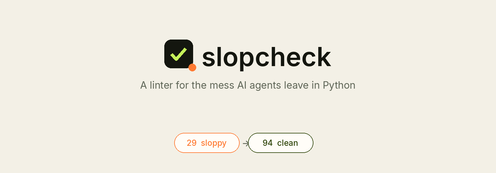
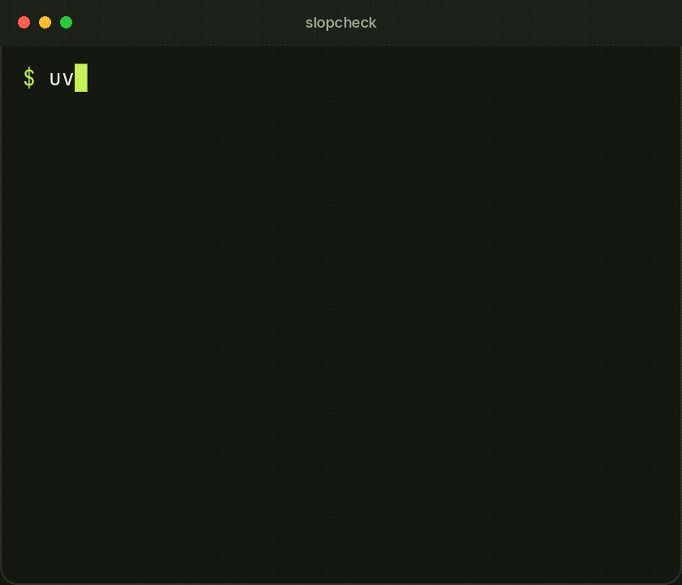
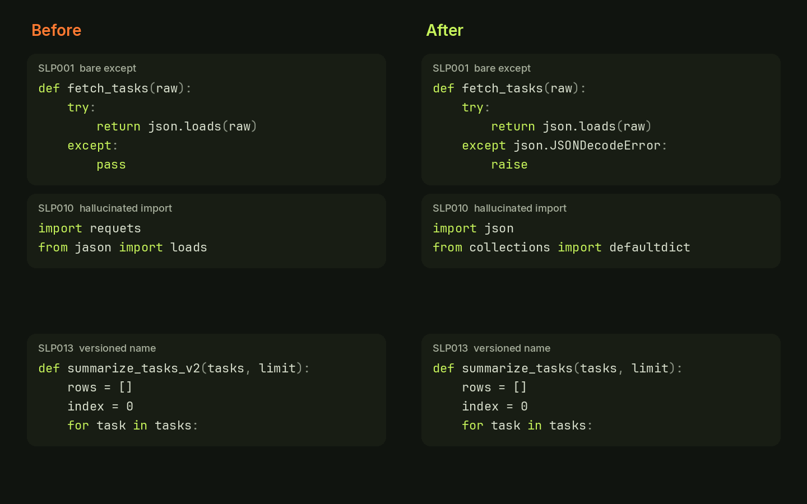
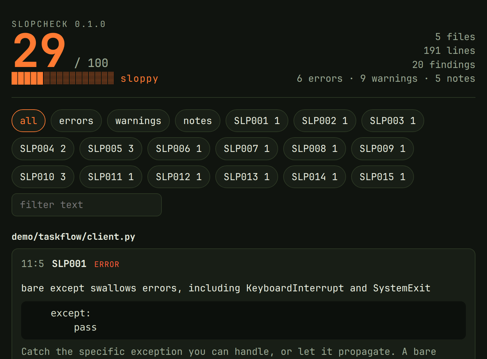

<p align="center"><strong>English</strong> · <a href="README.zh-CN.md">简体中文</a></p>

<p align="center">
  <picture>
    <source media="(prefers-color-scheme: dark)" srcset="docs/hero-dark.png">
    
  </picture>
</p>

<p align="center">
  <a href="https://pypi.org/project/slopcheck-lint/"></a>
  <a href="https://github.com/yungcs/slopcheck/actions/workflows/ci.yml"></a>
  <a href="LICENSE"></a>
  
  
</p>

<p align="center"><strong>One command. A score from 0 to 100. Higher is cleaner.</strong></p>

<p align="center">
  
</p>

Ruff and Pylint will not catch this. Agents still ship it: a bare `except`, `import requets`, a `_v2` twin, a `breakpoint()` left in the fetch path. slopcheck flags that residue and hands the findings to Claude Code, Codex, or Cursor.

## Install in 5 seconds

```bash
uvx --from slopcheck-lint slopcheck .
```

```bash
pipx install slopcheck-lint
```

```bash
pip install slopcheck-lint
```

The PyPI package is `slopcheck-lint`; the command it installs is `slopcheck`, and the import name stays `slopcheck`.

Python 3.10 or newer. From a checkout of this repo: `pip install -e ".[dev]"`.

## Quick start

```bash
slopcheck .                         # terminal report and a Slop Score
slopcheck . --format sarif -o slopcheck.sarif
slopcheck prompt . > fix.md         # paste into Claude Code, Codex, or Cursor
slopcheck . --fix-with-agent
```

The bundled demo is the messy tree in the GIF. It ends at `20 findings · score 29 · fail`. The plain transcript is [`docs/demo.txt`](docs/demo.txt). `demo/taskflow/ok.py`, scanned alone, scores 100.

An error weighs 8, a warning 4, a note 2. `budget = lines / 5`, and the score is `round(100 * budget / (budget + raw))`. No findings is 100. A 200-line project with five errors scores 50.

| Score | Label |
| --- | --- |
| 90–100 | clean |
| 75–89 | light residue |
| 50–74 | needs a wash |
| 25–49 | sloppy |
| 0–24 | hazardous sludge |

Exit `0` when nothing error-or-warning remains and the score clears `--min-score`. Exit `1` for findings, parse errors, or a score under the minimum. Exit `2` for bad arguments. Notes alone do not fail the process unless `min-score` says they do. `--exit-zero` always exits 0.

## Why

Agents write code that looks finished and fails quietly. Ruff is the fast linter (it will flag a bare `except` as E722). Pylint has its own score. Neither one is looking for the residue around that `except`.

| Pattern | Ruff / Pylint | slopcheck |
| --- | --- | --- |
| `except KeyError: return {}` | no | SLP003 |
| `import requets` | no | SLP010 |
| `summarize_tasks_v2` next to `summarize_tasks` | no | SLP007, SLP013 |
| `# increment index` above `index += 1` | no | SLP004 |
| `print(f"{tasks=}")` and `breakpoint()` | not by default | SLP005 |

Run both. Ruff formats and finds bugs. slopcheck is the pass after the agent.

<p align="center">
  
</p>

## Rules

| ID | Sev | What a tiny example looks like |
| --- | --- | --- |
| SLP001 | error | `except:` then `pass` |
| SLP002 | error | `except Exception: return None` |
| SLP003 | error | `except KeyError: return {}` |
| SLP004 | note | `# increment index` |
| SLP005 | warning | `print(f"{tasks=}")`, `breakpoint()` |
| SLP006 | warning | `def _helper(): ...` and nothing calls it |
| SLP007 | warning | a second function with the same shape |
| SLP008 | note | `name = "ada"` then `if name is not None` |
| SLP009 | warning | `def export_tasks(): pass` |
| SLP010 | error | `import requets` |
| SLP011 | warning | `try` inside `try` inside `try` |
| SLP012 | note | an essay docstring on `return len(tasks)` |
| SLP013 | warning | `def summarize_tasks_v2` |
| SLP014 | note | `# status = "archived"` |
| SLP015 | warning | `return "Error: failed to fetch title"` |

`slopcheck rules` prints the hint that ships with each finding.

Left alone on purpose: a comment that says why, `print(f"tasks={tasks}")` (the flagged form is `f"{tasks=}"`), imports inside `except ImportError`, abstract methods, `Protocol`, `.pyi` files, and `return False` from `__exit__`.

Silence a line with `# slopcheck: ignore[SLP003]`. A comment-only line applies to the next line of code. `# slopcheck: disable` covers the rest of the file until `# slopcheck: enable`.

```toml
[tool.slopcheck]
exclude = ["demo/**", "tests/fixtures/**"]
ignore = ["SLP004"]
min-score = 90

[tool.slopcheck.rules.SLP010]
allowed_modules = ["pytest"]
```

`--select` replaces the config selection. `--ignore` is added on top. This repo sets `min-score = 100` and excludes the demo, so `slopcheck .` fails on any finding. `slopcheck demo` opts that path back in.

<p align="center">
  
</p>

`slopcheck . --format html -o report.html` writes one file. No network requests. The same run as JSON, SARIF 2.1.0, or an SVG badge: `slopcheck badge . -o slop-score.svg`.

## Use with Claude Code, Codex, and Cursor

```bash
slopcheck prompt . > fix.md
```

The prompt says: keep behavior, raise instead of returning a dummy, do not silence rules to inflate the score, then run slopcheck again.

The skill is [`skills/slopcheck/SKILL.md`](skills/slopcheck/SKILL.md). The same file is linked from `.claude/skills`, `.cursor/skills`, and `.agents/skills`.

Claude Code can lint after each edit. Copy [`examples/hooks/slopcheck.sh`](examples/hooks/slopcheck.sh) and the matcher in [`examples/hooks/claude-code.settings.json`](examples/hooks/claude-code.settings.json).

## CI, pre-commit, GitHub Action

pre-commit, once `v0.1.0` is tagged:

```yaml
repos:
  - repo: https://github.com/yungcs/slopcheck
    rev: v0.1.0
    hooks:
      - id: slopcheck
```

GitHub Action, with SARIF upload for code scanning:

```yaml
- uses: yungcs/slopcheck@v0.1.0
  with:
    path: .
    upload-sarif: "true"
```

The action is [`action.yml`](action.yml). A full workflow is [`examples/workflows/slopcheck.yml`](examples/workflows/slopcheck.yml). CI for this repo runs pytest and `slopcheck .` on Python 3.10–3.13.

## Comparison

| | slopcheck | Ruff | Pylint | eslint-plugin-slop |
| --- | --- | --- | --- | --- |
| Language | Python | Python | Python | TypeScript |
| Fake fallback `return {}` | yes | no | no | no |
| Hallucinated import | yes | no | no | no |
| Near-duplicate `_v2` | yes | no | no | no |
| Narrating comments | yes | no | no | no |
| Score meant for agents | 0–100 | no | 0–10, different job | no |
| Fix prompt | yes | no | no | no |
| SARIF | yes | yes | no | via ESLint |
| Replaces the others | no | no | no | different language |

[eslint-plugin-slop](https://github.com/antfu/eslint-plugin-slop) is the TypeScript cousin. [no-ai-slop](https://github.com/petergyang/no-ai-slop) edits prose. [hallmark](https://github.com/Nutlope/hallmark) lints interface. This one is for Python.

## FAQ

**Does this replace Ruff?** No. Turn Ruff on. Add slopcheck for the residue Ruff is not built to name.

**Will it call my code AI-written?** No. It flags patterns. Humans write `except: pass` too.

**A note failed my build.** Notes weigh 2 points. They fail the process only when the score drops under `--min-score`. This repo uses 100, so a note fails `slopcheck .`.

**How do I keep a false positive?** `# slopcheck: ignore[SLP010]` on the line, or `allowed_modules` for an extra that is not installed here.

**Which Python?** 3.10, 3.11, 3.12, and 3.13.

## Roadmap

- Safe edits for narrating comments, commented-out code, and debug leftovers.
- A baseline file, so a dirty tree can ratchet forward.
- An LSP, so the score shows up while the agent is still typing.
- Hallucinated keyword arguments.
- A plugin API for rules that only make sense in one codebase.

## Contributing

See [CONTRIBUTING.md](CONTRIBUTING.md). `pytest` and `slopcheck .` should both be clean before you open a PR. The changelog is [CHANGELOG.md](CHANGELOG.md).

## Star history

<p align="center">
  <a href="https://star-history.com/#yungcs/slopcheck&Date">
    <picture>
      <source media="(prefers-color-scheme: dark)" srcset="https://api.star-history.com/svg?repos=yungcs/slopcheck&type=Date&theme=dark">
      <source media="(prefers-color-scheme: light)" srcset="https://api.star-history.com/svg?repos=yungcs/slopcheck&type=Date">
      
    </picture>
  </a>
</p>

## License

[MIT](LICENSE)
