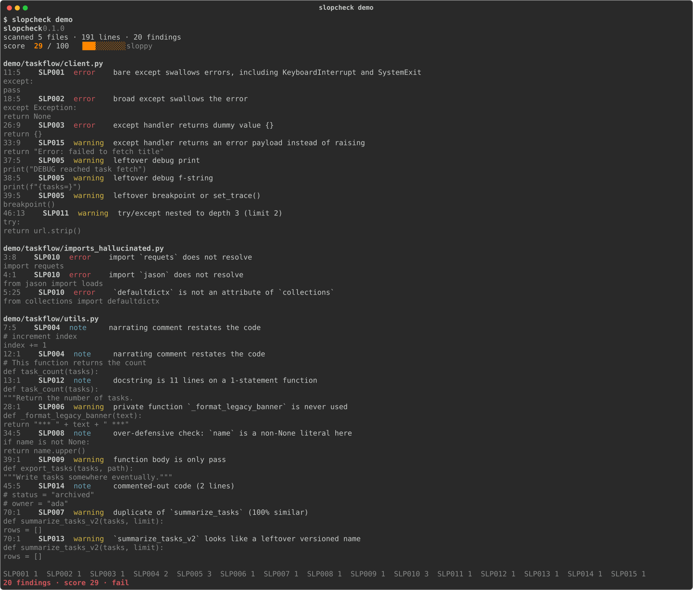

# slopcheck

给 AI 编程代理留在 Python 里的污泥做体检。

[English](README.md)

[](docs/slop-score.svg)


一条命令扫完 Python 代码，标出代理留下的污泥，并给出 **Slop Score**（0 到 100，越高越干净）。同一份结果可以交给 Claude Code、Codex 或 Cursor 去改。

```bash
uvx slopcheck .
```

在本仓库里：

```bash
pip install -e ".[dev]"
slopcheck .
```

包发布之后，`pipx install slopcheck` 同样可用。需要 Python 3.10 或更新版本。

## 演示

`demo/taskflow` 是一个任务客户端，写法很像代理在赶工：裸 `except`、幻觉出来的 `requets`、已经有原函数还再写一份 `_v2`，以及留在请求路径上的 `breakpoint()`。同目录的 `demo/taskflow/ok.py` 是对照。单独扫描它，分数是 100。



下面是同一次运行的纯文本。规则编号保持英文，和终端输出一致。

```text
$ slopcheck demo
slopcheck  0.1.0
scanned 5 files · 191 lines · 20 findings
score   29 / 100  ███░░░░░░░  sloppy

demo/taskflow/client.py
  11:5  SLP001  error    bare except swallows errors, including KeyboardInterrupt and SystemExit
            except:
                pass
  18:5  SLP002  error    broad except swallows the error
            except Exception:
                return None
  26:9  SLP003  error    except handler returns dummy value {}
                return {}
  33:9  SLP015  warning  except handler returns an error payload instead of raising
                return "Error: failed to fetch title"
  37:5  SLP005  warning  leftover debug print
            print("DEBUG reached task fetch")
  38:5  SLP005  warning  leftover debug f-string
            print(f"{tasks=}")
  39:5  SLP005  warning  leftover breakpoint or set_trace()
            breakpoint()
  46:13  SLP011  warning  try/except nested to depth 3 (limit 2)
                    try:
                        return url.strip()

demo/taskflow/imports_hallucinated.py
  3:8  SLP010  error    import `requets` does not resolve
        import requets
  4:1  SLP010  error    import `jason` does not resolve
        from jason import loads
  5:25  SLP010  error    `defaultdictx` is not an attribute of `collections`
        from collections import defaultdictx

demo/taskflow/utils.py
  7:5  SLP004  note     narrating comment restates the code
            # increment index
            index += 1
  12:1  SLP004  note     narrating comment restates the code
        # This function returns the count
        def task_count(tasks):
  13:1  SLP012  note     docstring is 11 lines on a 1-statement function
        def task_count(tasks):
            """Return the number of tasks.
  28:1  SLP006  warning  private function `_format_legacy_banner` is never used
        def _format_legacy_banner(text):
            return "*** " + text + " ***"
  34:5  SLP008  note     over-defensive check: `name` is a non-None literal here
            if name is not None:
                return name.upper()
  39:1  SLP009  warning  function body is only pass
        def export_tasks(tasks, path):
            """Write tasks somewhere eventually."""
  45:5  SLP014  note     commented-out code (2 lines)
            # status = "archived"
            # owner = "ada"
  70:1  SLP007  warning  duplicate of `summarize_tasks` (100% similar)
        def summarize_tasks_v2(tasks, limit):
            rows = []
  70:1  SLP013  warning  `summarize_tasks_v2` looks like a leftover versioned name
        def summarize_tasks_v2(tasks, limit):
            rows = []

SLP001 1  SLP002 1  SLP003 1  SLP004 2  SLP005 3  SLP006 1  SLP007 1  SLP008 1  SLP009 1  SLP010 3  SLP011 1  SLP012 1  SLP013 1  SLP014 1  SLP015 1
20 findings · score 29 · fail
```

同一份结果的单页报告：[docs/demo-report.html](docs/demo-report.html)。用浏览器打开。筛选按钮写在文件里，不请求网络。

重新生成图片、文本、徽章和 HTML：

```bash
python scripts/render_assets.py
```

## 规则

| ID | 级别 | 名称 | 抓什么 |
| --- | --- | --- | --- |
| SLP001 | error | bare-except | 裸 `except:`，连 KeyboardInterrupt 和 SystemExit 一起吞掉 |
| SLP002 | error | broad-except-swallow | `except Exception` 的函数体只有 pass、continue，或返回 None/False |
| SLP003 | error | fake-fallback | `except` 返回 `{}`、`[]`、`""`、`0`、`"ok"`、`"todo"` 这类假数据 |
| SLP004 | note | narrating-comment | `# increment i`、`# This function returns the count` 这种复述 |
| SLP005 | warning | debug-leftover | 调试用的 `print`、`f"{var=}"`、`breakpoint()`、`pdb.set_trace()` |
| SLP006 | warning | unused-private | 文件里没有人调用的 `_helper` |
| SLP007 | warning | near-duplicate | 结构几乎一样的第二个函数 |
| SLP008 | note | over-defensive | 根据上面的代码不可能失败的 `None` 或 `isinstance` 检查 |
| SLP009 | warning | placeholder-stub | 函数体只有 `pass`、`...`、`NotImplementedError` 或 TODO 返回值 |
| SLP010 | error | hallucinated-import | 解析不到的模块，或标准库里不存在的属性 |
| SLP011 | warning | try-nesting | 同一个函数里 `try` 嵌套超过 2 层 |
| SLP012 | note | verbose-docstring | 一两行函数上面挂着长 docstring |
| SLP013 | warning | versioned-name | `*_v2`、`*_fixed`、`*_copy`，以及旁边还留着原名的 `*_new` |
| SLP014 | note | commented-out-code | 注释里其实是代码 |
| SLP015 | warning | error-string-return | `except` 返回 `"Error: ..."` 或 `{"success": false}`，而不是抛出 |

`slopcheck rules` 会打印当前规则，包括每条发现附带的修改提示。

故意不报的情况：

- 注释在解释原因（`# Retry once: the upstream closes idle sockets`）。
- `print(f"tasks={tasks}")`。会报的是自描述形式 `f"{tasks=}"`。
- 写在 `try/except ImportError` 里的可选导入。
- 抽象方法、`Protocol` 方法体，以及 `.pyi`。
- `__exit__` / `__aexit__` 里的 `return False`。
- 旁边没有 `brand` 函数时，函数名叫 `brand_new`。

关掉一行，或关掉整个文件：

```python
result = load()  # slopcheck: ignore[SLP003]
```

```python
# slopcheck: disable
# slopcheck: enable=SLP001
```

`# slopcheck: ignore` 不写编号，表示这一行所有规则都不报。单独占一行的注释会作用到下一个非空行。

## 分数

error 记 8 分，warning 记 4 分，note 记 2 分。权重加进 raw，行数决定预算。

```text
budget = lines / 5
raw    = 权重之和
score  = round(100 * budget / (budget + raw))
```

没有任何发现时分数是 100，跟行数无关。200 行代码加上 5 个 error（raw = 40），分数是 50。

| 分数 | 标签 |
| --- | --- |
| 90–100 | clean |
| 75–89 | light residue |
| 50–74 | needs a wash |
| 25–49 | sloppy |
| 0–24 | hazardous sludge |

退出码：

| 码 | 时机 |
| --- | --- |
| 0 | 没有 error、没有 warning，且分数不低于 `--min-score` |
| 1 | 出现 error、warning、语法错误，或分数低于下限 |
| 2 | 参数错误，或配置文件坏了 |

只有 note 时进程不会失败。note 会拉低分数，所以 `min-score = 100` 时一条 note 也会失败。`--exit-zero` 在写完报告后始终以 0 退出。

## 配置

slopcheck 读取最近的 `pyproject.toml` 里的 `[tool.slopcheck]`。连字符和下划线是同一个键。不认识的键会警告并忽略。`--no-config` 跳过项目配置。`--config other.toml` 改读那个文件。

```toml
[tool.slopcheck]
exclude = ["demo/**", "tests/fixtures/**"]
ignore = ["SLP004"]
min-score = 90

[tool.slopcheck.severity]
SLP008 = "warning"

[tool.slopcheck.per-file-ignores]
"tests/**" = ["SLP009"]

[tool.slopcheck.rules.SLP007]
min_lines = 12
min_tokens = 25
threshold = 0.92

[tool.slopcheck.rules.SLP010]
allowed_modules = ["pytest"]

[tool.slopcheck.rules.SLP011]
max_depth = 2

[tool.slopcheck.rules.SLP012]
min_doc_lines = 8
max_body_statements = 2
```

`--select` 替换配置里的选择。`--ignore` 追加到配置的忽略列表上。本仓库排除了 `demo/**` 和 `tests/fixtures/**`，并把 `min-score` 设为 100，所以 `slopcheck .` 遇到任何发现都会失败。命令行直接传入这些路径会重新纳入扫描：`slopcheck demo` 会扫演示目录。

## 输出

| 格式 | 命令 |
| --- | --- |
| 终端 | `slopcheck .` |
| JSON | `slopcheck . --format json` |
| SARIF 2.1.0 | `slopcheck . --format sarif -o slopcheck.sarif` |
| HTML | `slopcheck . --format html -o report.html` |
| SVG 徽章 | `slopcheck badge . -o slop-score.svg` |
| 修复提示 | `slopcheck prompt .` |

`--quiet` 每条发现一行，最后再给分数。`--verbose` 附上修改提示。`--no-color` 和 `--no-snippet` 适合写进日志。

JSON 里有分数、权重、每条发现、语法错误，以及按规则汇总的数量。SARIF 使用相对路径，`uriBaseId` 为 `%SRCROOT%`，驱动里列出全部 15 条规则。HTML 报告是单个文件：内联 CSS、一行筛选按钮、全部发现。徽章的颜色直接写在 `fill` 上，GitHub README 里也能显示。

## 把发现交给代理

```bash
slopcheck prompt demo > fix.md
slopcheck src/app.py --fix-with-agent
```

提示词要求代理保持行为、该抛出的不要改成假返回值，然后重新运行 slopcheck。贴进 Claude Code、Codex 或 Cursor 即可。[`skills/slopcheck/SKILL.md`](skills/slopcheck/SKILL.md) 说的是同一件事，并且明确不要靠关掉规则来抬分数。`.claude/skills`、`.cursor/skills`、`.agents/skills` 里是同一份文件的链接。

```python
from slopcheck import scan

report = scan(["src"])
print(report.score, report.label)
```

## 集成

**pre-commit。** [`.pre-commit-hooks.yaml`](.pre-commit-hooks.yaml) 检查暂存的 Python 文件。接入示例在 [`examples/pre-commit-config.yaml`](examples/pre-commit-config.yaml)。把里面的 `OWNER` 换成真正托管这个包的仓库。

**GitHub Actions。** [`action.yml`](action.yml) 安装 slopcheck、写出 SARIF，并上传到 code scanning。[`examples/workflows/slopcheck.yml`](examples/workflows/slopcheck.yml) 调用这个 action。[`.github/workflows/ci.yml`](.github/workflows/ci.yml) 在 Python 3.10 到 3.13 上跑测试和 `slopcheck .`。

**Claude Code 钩子。** [`examples/hooks/slopcheck.sh`](examples/hooks/slopcheck.sh) 在 Write 或 Edit 之后检查 `.py` 文件。匹配规则在 [`examples/hooks/claude-code.settings.json`](examples/hooks/claude-code.settings.json)。

## 对照

散文和界面已经有人在查 AI 味。[no-ai-slop](https://github.com/petergyang/no-ai-slop) 写这篇说明时大约 1.28 万 star，查的是 AI 腔的文章。[hallmark](https://github.com/Nutlope/hallmark) 大约 3.26 万 star，查的是 AI 腔的界面。[eslint-plugin-slop](https://github.com/antfu/eslint-plugin-slop) 做的是 TypeScript。slopcheck 做 Python：语法树和 token、一个分数、SARIF，以及一份代理能执行的修复提示。

## 路线图

- 对复述注释、注释掉的代码、调试残留做不改变行为的自动修复。
- 基线文件。脏仓库可以只要求新代码变干净，而不是一次清完。
- LSP。代理还在打字时就能看到分数。
- 幻觉出来的关键字参数，不只是幻觉出来的 import。
- 插件 API，给只在某一个代码库里有意义的规则用。

## 许可证

[MIT](LICENSE)
